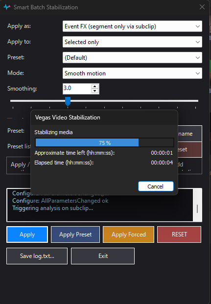
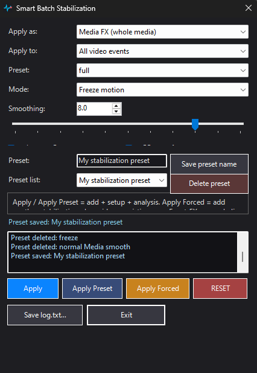
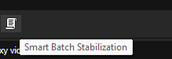
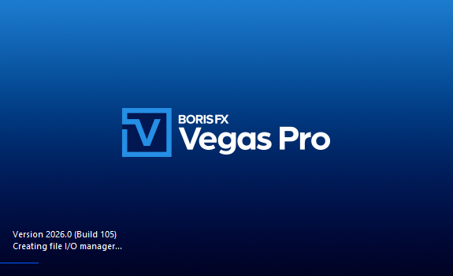

# skills-vegas_pro

**Vegas Pro scripting — real skills, battle-tested. Free and open for everyone.**
مهارات حقيقية للسكربت في Vegas Pro، مجربة عمليًا — ومجانية للجميع.

> ⚡ Stop guessing why your Vegas Pro script crashes. This repository documents every failure we found, why it happens, and the exact pattern that survives open hours in production.
> توقف عن تخمين لماذا ينهار سكربتك في Vegas Pro — هنا كل سبب ومواجهته وطريقة إصلاحه.

---

## About  About | نبذة

This repository teaches developers how to build, debug and ship real **Vegas Pro** scripts using the **ScriptPortal.Vegas** .NET scripting API — with everything we learned the hard way by shipping a production tool (Vegas Pro 2026, BorisFX / Magix build `2026.0.0+105`).

كل قاعدة في هذا المستودع مصدرها منتج حقيقي انهار ثم حُفّظ: أداة تثبيت دفعي **Smart Batch Stabilization** التي تكسر Vegas Pro عند كل مؤشر خاطئ.

---

## Screenshots | صور للأداة المجانية

Four images from the real production script running on Vegas Pro 2026 (Build 105).
أربع صور للسكربت الفعلي وهو يعمل على Vegas Pro 2026 (Build 105).

| # | File | What it shows | ماذا تُظهر |
|---|------|---------------|------------|
| 1 | `docs/screenshots/01-analysis-running.png` | Vegas Video Stabilization running at 75% on the selected clip (Event FX via subclip). | نافذة Vegas Video Stabilization عند 75% أثناء التحليل |
| 2 | `docs/screenshots/02-freeze-applied.png` | Full preset + Freeze motion, smoothing 8.0, Media FX on all video events, with log output saved. | Full + Freeze (smoothing 8.0) مُطبّقة على كامل الفيديو مع سجل الحفظ |
| 3 | `docs/screenshots/03-script-caption.png` | The script's caption appears beside the Vegas Pro toolbar when run. | التعليق البرمجي للسكربت يظهر جانب الواجهة في Vegas Pro |
| 4 | `docs/screenshots/04-vegas-pro-splash.png` | Vegas Pro 2026 splash screen — Version 2026.0 (Build 105). | شاشة الإقلاع الرسمية 2026.0 Build 105 |

### Row of images

```markdown




```


---

## Repository layout | بنية المستودع

```
skills-vegas_pro/
├── README.md                  ← this file
├── LICENSE                    ← Apache-2.0
├── CONTRIBUTING.md            ← how to contribute
├── docs/
│   └── screenshots/           ← UI screenshots from the production script
└── scripts/
    ├── SKILL.md               ← the main skill (read this first)
    └── assets/
        ├── SmartBatchStabilization.cs  ← working reference script
        └── DiagnoseVideoFX.cs          ← diagnostic tool
```

---

## Quick start | البدء السريع

### English

1. Install Vegas Pro 2026 (free trial of Vegas Pro is available).
2. Copy `scripts/assets/*.cs` into your Vegas Pro `Script Menu` folder:
   - Program folder (admin required): `C:\Program Files\BorisFX\Vegas Pro 2026\Script Menu`
   - User documents (no admin):      `%USERPROFILE%\Documents\Vegas Pro 2026\Script Menu`
3. Restart Vegas Pro.
4. From the menu: `Tools > Scripting > Run Script > SmartBatchStabilization.cs`.

### العربية

1. ثبّت Vegas Pro 2026.
2. انسخ `scripts/assets/*.cs` إلى مجلد `Script Menu`:
   - مجلد البرنامج (يحتاج صلاحيات المدير): `C:\Program Files\BorisFX\Vegas Pro 2026\Script Menu`
   - مجلد المستندات (بدون مدير): `%USERPROFILE%\Documents\Vegas Pro 2026\Script Menu`
3. أعد تشغيل Vegas Pro.
4. من القائمة: `Tools > Scripting > Run Script > SmartBatchStabilization.cs`.

---

## What's inside the skill | محتوى المهارة

### English

- The Vegas Pro scripting model (API, project layout, entry points)
- The **one** safe way to build a script-hosted dialog — and why others crash
- Adding and removing OFX effects programmatically (Event FX, Media FX, subclips)
- The complete failure catalog: symptom → cause → fix
  - `COMException 0x8000FFFF` (catastrophic failure)
  - `Invalid video motion keyframe`
  - `HRESULT E_FAIL` / `E_UNEXPECTED`
  - Crashes during / after OFX analysis
  - Crashes on reapply, reset, and empty reset
  - `Failed via subclip` after a prior apply
- Production patterns: logging, success/failure sounds, Ctrl+S autosave, idempotence
- QA checklist

### العربية

- نموذج السكربت في Vegas Pro (API، التخطيط، نقاط الدخول)
- الطريقة **الوحيدة** الآمنة لبناء نافذة من السكربت — ولماذا الأخريات تنهار
- إضافة وإزالة مؤثرات OFX برمجيًا (Event FX، Media FX، subclips)
- فهرس الأخطاء الكامل: العرض → السبب → الحل
  - `COMException 0x8000FFFF` (انهيار قاتل)
  - `Invalid video motion keyframe`
  - `HRESULT E_FAIL` / `E_UNEXPECTED`
  - الانهيارات أثناء/بعد تحليل OFX
  - الانهيار عند إعادة التطبيق أو الإلغاء أو الإلغاء على مشروع فارغ
  - `Failed via subclip` بعد تطبيق سابق
- أنماط الإنتاج: السجل، أصوات النجاح/الفشل، Ctrl+S وحفظ تلقائي، idempotency
- قائمة التحقق قبل التسليم

---

## Licence | الترخيص

Apache-2.0 — free for everyone, commercial use included. See `LICENSE`.

**شور هذي النقطة:** كل ملف في هذا المستودع مرخّص تحت Apache-2.0 — أي شخص يمكنه استخدامه وتعديله وتوزيعه بما يريد، بدون مقابل وبدون ترخيص خاص.

---

## Credits | الشكر والائتمان

Built from real production work on Vegas Pro 2026.0.0+105 (BorisFX / Magix). No third-party proprietary code is redistributed.

"Skills" here means: knowledge harvested from actual failures and actual repairs. Not marketing copy, not theoretical advice.
